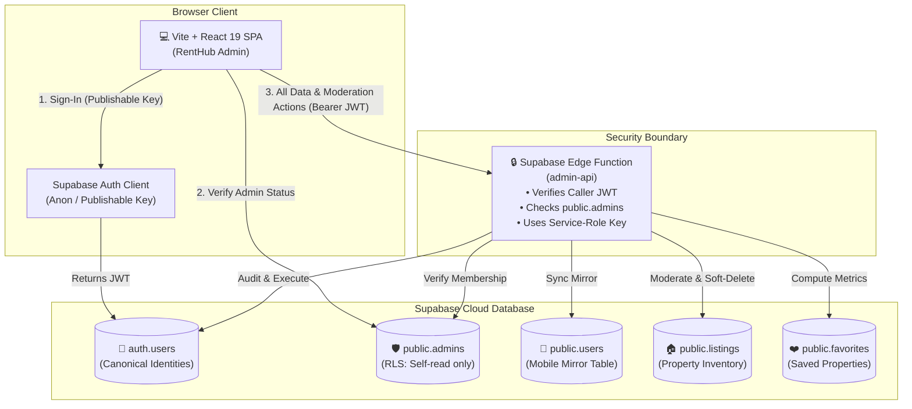
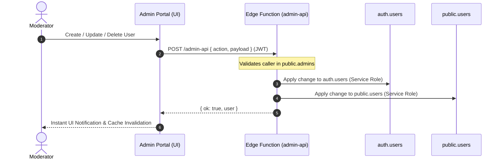

# 🛡️ RentHub Admin Portal — Hackathon Edition

> **A high-security, real-time command center for the RentHub ecosystem. Built with React 19, Vite, and TypeScript, engineered with a Zero-Trust security model that protects service-role credentials via a privileged Supabase Edge Function.**

[](https://react.dev)
[](https://vitejs.dev)
[](https://www.typescriptlang.org)
[](https://supabase.com)
[](https://vercel.com)
[](https://oxc.rs)

---

## 📌 Executive Summary & Hackathon Pitch

### 🛑 The Problem
Rental marketplaces suffer from rampant spam, fraudulent listings, unverified property owners, and abusive user behavior. Moreover, admin panels built in hackathons frequently expose sensitive `service_role` database master keys to client-side bundles, creating critical security risks and database takeover vulnerabilities.

### 💡 The Solution: RentHub Admin
**RentHub Admin** delivers an enterprise-grade, zero-trust administrative suite that empowers platform moderators to supervise users, enforce quality standards, and monitor platform traction safely:
1. **Zero-Trust Security Boundary:** The browser **never** holds the `service_role` key. All privileged mutations and cross-table operations are channeled through an isolated Supabase Edge Function (`admin-api`) protected by JWT verification and an immutable admin membership table.
2. **Dual-Store Identity Synchronization:** Solves identity drift by keeping Supabase Auth (`auth.users`), user profiles (`public.profiles`), and the mobile application's database (`public.users`) synchronized in atomic lockstep.
3. **Instant First-Run Self-Sealing Bootstrap:** When freshly deployed, the portal enables a one-time onboarding flow to initialize the first administrator. Once claimed, the bootstrap path is permanently sealed at the database level.
4. **Sub-Second Reactive UI:** Utilizes lightweight reactive client caching (`useQuery`) with debounce controls and targeted cache tag invalidation (`invalidateQuery`), giving moderators instant feedback without UI stutter.

---

## 🏛️ Ecosystem Integration & Security Model



### The 3 Core Tenets of the Security Architecture
1. **No Master Keys in the Browser:** The frontend only uses the public Supabase publishable key (`sb_publishable_...`).
2. **Strict Function-Level Authorization:**
   - Every invocation of `admin-api` extracts the caller's JWT from the `Authorization: Bearer <token>` header.
   - It validates that the caller's UUID exists in `public.admins`. Non-admin users are rejected with HTTP 403 Forbidden.
3. **Permanent Self-Sealing Bootstrap:**
   - When `public.admins` contains zero rows, the Edge Function exposes a one-time `bootstrapAdmin` action.
   - The instant the first administrator registers, the bootstrap pathway is permanently locked:
   $$\text{count}(\text{public.admins}) > 0 \implies \text{Setup Closed (400 Bad Request)}$$

---

## 🔄 Dual-Store Identity Synchronization

Because the platform supports both modern Supabase Auth and legacy mobile clients, users exist across two synchronized layers:
1. **`auth.users` + `public.profiles`:** Supabase canonical identity containing secure password hashes, email confirmation status, and session tokens.
2. **`public.users`:** Relational mirror read by the Cloudflare Worker backend for mobile application operations.

### Synchronized Operations Matrix



- **User Creation:** Generates a pre-confirmed user in `auth.users` and simultaneously inserts their record into `public.users`.
- **Profile Edits:** Updates name, phone, and role (`tenant` vs `owner`) across both representations.
- **Password Resets:** Triggers an administrative password update via the service-role Auth API so the user can immediately log in on mobile.
- **Safe Cascade Deletion:** Deleting a user cleans up their `auth.users` entry, cascaded profiles, and mirror record in `public.users`. Safety guardrails strictly prevent an admin from deleting themselves or deleting the last remaining administrator on the platform.

---

## ✨ Features Breakdown & Screen Guide

### 1. 📊 Executive Dashboard (`src/pages/DashboardPage.tsx`)
The primary landing view gives platform operators high-level situational awareness:
- **Real-Time KPI StatCards:**
  - **Tenants:** Count of registered renters actively seeking housing.
  - **Owners:** Count of registered property owners and landlords.
  - **Listings:** Total inventory count with dynamic badge showing available vs unavailable properties.
  - **Saved Homes:** Aggregate count of bookmarked properties across all tenants.
  - **New Signups:** Verified accounts created in the last 7 rolling days.
- **Newest Accounts Ledger:** Quick-look table showing the most recent accounts with instant role badges, join date, and timestamp of their last active session.

### 2. 👥 User Management Hub (`src/pages/UsersPage.tsx`)
Full governance over platform participants:
- **Instant Debounced Search:** Search across users by name or email with automatic 250ms debouncing to minimize unnecessary API load.
- **Role Segment Filter:** Quickly isolate **All**, **Tenants**, or **Owners**.
- **Modal User Creation:** Administrative modal to provision new tenant or owner accounts with predefined credentials.
- **In-Place User Details Editing:** Update names, telephone numbers, and promote/demote roles between tenant and owner.
- **Administrative Password Reset:** Dedicated modal allowing administrators to set a fresh temporary password for locked-out users.
- **Safety-Gated Account Deletion:** Confirmation dialog preventing accidental clicks, self-deletion, or deletion of the last admin.

### 3. 🏠 Listings Moderation (`src/pages/ListingsPage.tsx`)
Real-time property inventory oversight:
- **Live Inventory Search:** Search across all listings by title, city, or address.
- **One-Tap Availability Toggle:** Immediately toggle a listing between `Available` (live in renter feeds) and `Unavailable` (taken offline for compliance/moderation).
- **Listing Removal:** Permanently delete spam, duplicate, or policy-violating property listings with a confirmation dialog.
- **Owner Attribution:** View which owner published each property, along with pricing and thumbnail previews.

### 4. 🔐 Authentication & First-Run Setup (`src/pages/LoginPage.tsx`)
- **Self-Detecting Mode:** Automatically queries `admin-api` (`status` action) to check if the platform is in **First-Run Setup Mode** or **Standard Login Mode**.
- **Admin Verification:** Upon sign-in, validates that the user's ID exists in `public.admins`; non-admin users are automatically signed out with a clear warning.

---

## ⚡ Client-Side Architecture & Performance

### 1. Custom Reactive Cache Hook (`src/lib/useQuery.ts`)
Instead of bloated external state-management libraries, RentHub Admin implements a custom in-memory reactive query cache:
- **Stale-While-Revalidate:** Instantly renders cached results while fetching updates in the background.
- **Tag-Based Invalidation:** Mutations trigger prefix invalidations (e.g. `invalidateQuery(LISTINGS_PREFIX)` and `invalidateQuery(STATS_PREFIX)`), ensuring every screen displays live data as soon as an action completes.

### 2. Design System & Theming (`src/styles.css`)
- Clean, modern, responsive interface utilizing CSS custom properties for themes, glass panels, soft drop-shadows, and thumb-friendly interactive controls.
- Fully responsive layout with mobile drawer navigation and high-contrast accessibility tags.

---

## 📁 Project Directory Structure

```
houserent-admin/
├── index.html                  # HTML entry point with modern viewport meta tags
├── package.json                # Dependencies (React 19, Vite 8, TypeScript 6)
├── tsconfig.json               # TypeScript workspace configuration
├── vercel.json                 # Vercel SPA client-side rewrite rules
├── vite.config.ts              # Vite configuration with React SWC plugin
├── supabase/
│   └── functions/
│       └── admin-api/
│           └── index.ts        # Privileged Supabase Edge Function (Service-Role Orchestrator)
└── src/
    ├── App.tsx                 # Client-side router and protected layout wrapper
    ├── main.tsx                # React 19 root bootstrap
    ├── styles.css              # Custom design system (panels, cards, modals, tables)
    ├── types.ts                # TypeScript interfaces (AdminUserRow, ListingRow, Stats)
    ├── components/             # Reusable UI component library
    │   ├── Alert.tsx           # Toast & inline notification banners (success / error)
    │   ├── Badge.tsx           # Status chips (tenant, owner, active, unavailable)
    │   ├── ConfirmDialog.tsx   # Destructive action modal confirmation dialog
    │   ├── Layout.tsx          # Main dashboard shell (header, sidebar navigation, user badge)
    │   ├── Modal.tsx           # Accessible modal container with backdrop blur
    │   ├── ProtectedRoute.tsx  # Route guard redirecting non-admins to /login
    │   ├── StartupError.tsx    # Configuration diagnostics screen for missing env vars
    │   └── StatCard.tsx        # KPI metrics card with trend indicators
    ├── context/
    │   └── AuthContext.tsx     # Admin session provider & bootstrap detector
    ├── lib/
    │   ├── adminApi.ts         # Edge function RPC client (typed actions & error unwrapping)
    │   ├── format.ts           # Date, time, and INR currency formatting utilities
    │   ├── queryKeys.ts        # Deterministic cache keys and invalidation prefixes
    │   ├── supabase.ts         # Initialized Supabase browser client
    │   └── useQuery.ts         # Lightweight in-memory reactive caching hook
    └── pages/
        ├── DashboardPage.tsx   # KPI statistics & recent accounts overview
        ├── ListingsPage.tsx    # Property inventory search & moderation controls
        ├── LoginPage.tsx       # Admin authentication & first-run setup wizard
        └── UsersPage.tsx       # User search, creation, editing & password reset
```

---

## 🗄️ Database Objects & Edge Function Actions

### 1. Admins Membership Table
Defined in Supabase PostgreSQL:
```sql
CREATE TABLE public.admins (
  user_id    UUID PRIMARY KEY REFERENCES auth.users(id) ON DELETE CASCADE,
  email      TEXT,
  created_at TIMESTAMPTZ NOT NULL DEFAULT NOW()
);

-- Row Level Security: Admins can only view their own membership row
ALTER TABLE public.admins ENABLE ROW LEVEL SECURITY;
CREATE POLICY "admins can read own row" ON public.admins
  FOR SELECT TO authenticated USING (auth.uid() = user_id);
```

### 2. Edge Function Action Map (`admin-api/index.ts`)

| Action | Auth Required | Description |
| :--- | :---: | :--- |
| `status` | ❌ No | Checks whether `public.admins` is empty (`setupRequired: boolean`) |
| `bootstrapAdmin` | ❌ No (Self-Limiting) | Creates the first admin in `auth.users` & `public.admins`; fails if an admin already exists |
| `stats` | ✅ Yes (Admin) | Computes real-time platform metrics (tenants, owners, listings, favorites, signups) |
| `listUsers` | ✅ Yes (Admin) | Merges `auth.users` and `public.users` with search & role filtering |
| `createUser` | ✅ Yes (Admin) | Provisions a new user in both `auth.users` and `public.users` |
| `updateUser` | ✅ Yes (Admin) | Updates profile attributes across both tables |
| `setPassword` | ✅ Yes (Admin) | Updates a user's password securely via Supabase Auth Admin API |
| `deleteUser` | ✅ Yes (Admin) | Deletes a user across all tables (preventing self or last-admin deletion) |
| `listListings` | ✅ Yes (Admin) | Returns all platform listings with owner names and coordinates |
| `setListingAvailable` | ✅ Yes (Admin) | Toggles property availability flag on/off |
| `deleteListing` | ✅ Yes (Admin) | Permanently deletes a property listing |

---

## 🛠️ Setup & Local Development

### 1. Prerequisites
- **Node.js:** v18.0.0 or newer
- **npm:** v9.0.0 or newer
- An existing **Supabase project** with the `admin-api` Edge Function deployed

### 2. Installation
```bash
# Navigate to admin panel directory
cd houserent-admin

# Install dependencies
npm install
```

### 3. Environment Configuration
Create a `.env` file in the root directory:
```env
VITE_SUPABASE_URL=https://whpeabltxdrtjkkckhqo.supabase.co
VITE_SUPABASE_ANON_KEY=eyJhbGciOiJIUzI1NiIsInR5cCI6IkpXVCJ9...
```
*(Both variables use the public publishable anon key and are completely safe to expose in the browser bundle).*

### 4. Start Development Server
```bash
npm run dev
# Running at http://localhost:5173
```

---

## ☁️ Deployment Guide

### Deploying the Web Frontend to Vercel
1. Push your code to GitHub.
2. Import the `houserent-admin` repository into [Vercel](https://vercel.com).
3. Framework Preset: **Vite**.
4. Configure Environment Variables in **Project Settings → Environment Variables**:
   - `VITE_SUPABASE_URL`: Your Supabase Project URL
   - `VITE_SUPABASE_ANON_KEY`: Your Supabase Publishable Anon Key
5. Deploy! Client-side routes are automatically rewritten to `index.html` via [`vercel.json`](file:///home/barry/Desktop/hackaton/houserent-admin/vercel.json).

### Deploying the Edge Function to Supabase
```bash
# Login to Supabase CLI
npx supabase login

# Deploy the admin-api Edge Function with verify-jwt disabled 
# (the function handles its own caller token verification)
npx supabase functions deploy admin-api --no-verify-jwt
```

---

## 🧪 Hackathon Judge's 2-Minute Walkthrough

1. **Launch Portal:**
   - Open the web application.
   - If setting up for the first time, observe the **"Create the first administrator account"** setup wizard.
   - Once signed in, you will be directed to the **Dashboard**.
2. **Review Real-Time Platform Traction:**
   - Inspect the **StatGrid**; note the real-time tally of Tenants, Owners, Total Listings, and 7-Day New Signups.
3. **Test Content Moderation:**
   - Navigate to the **Listings** tab.
   - Search for any listed property (e.g. *"Indiranagar"*).
   - Click **"Take Offline"**; notice the listing immediately turns unavailable and updates the dashboard counts in real time.
4. **Test Safe User Management:**
   - Navigate to the **Users** tab.
   - Filter by **"Owners"** or **"Tenants"**.
   - Click **"Create User"** to provision a test user and observe them immediately appearing in both the admin table and the mobile app database.
   - Try deleting your own admin account; observe the safety rail banner: *"You cannot delete your own account."*

---

## 👥 Hackathon Team

Developed with passion by the **RentHub Team**.
- **Admin Frontend:** React 19, TypeScript, Vite & Custom CSS
- **Edge Security:** Supabase Edge Functions (Deno / TypeScript)
- **Database & Auth:** Supabase PostgreSQL & Supabase Auth
